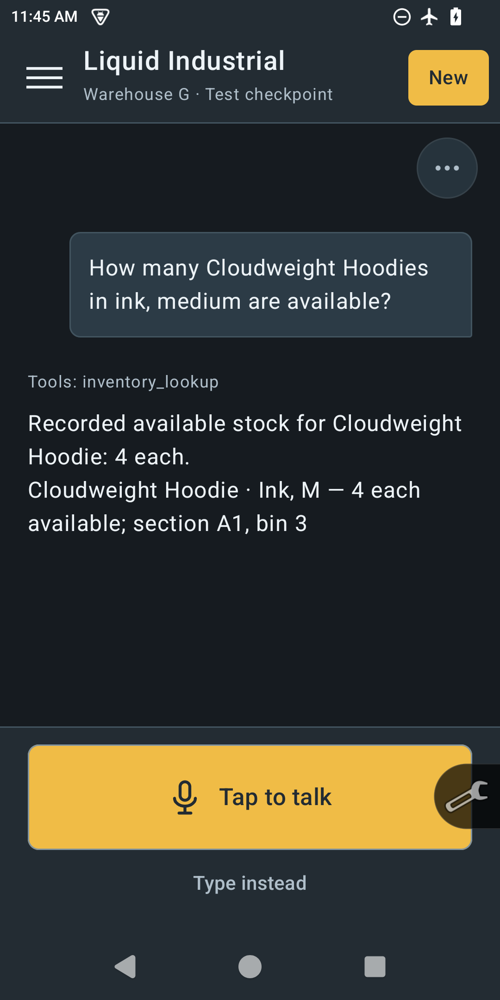
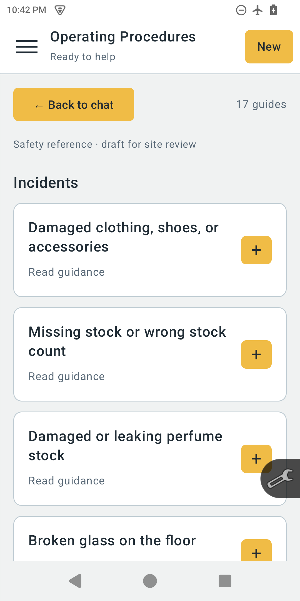
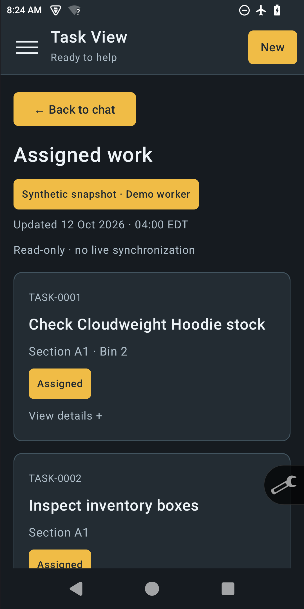

# Warehouse Floor Assistant

An offline-first Android proof of concept for warehouse floor workers using a Zebra device. Voice is the primary input; typed requests are also supported.

Workers can look up stock and locations, request replenishment, consult approved operating procedures, and create confirmed local reports. A custom 600M audio checkpoint (private) interprets supported requests. The harness owns retrieval, clarification, confirmation, persistence, and response formatting.

## Worker experience

- **General:** stock and location lookup for one product, or up to two product names; replenishment requests; assigned-task summaries.
- **SOP Advisor:** approved procedure cards with an optional report offer. Guidance alone never creates a ticket.
- **Writes:** readable preview and explicit confirmation. Confirmed replenishment updates the local inventory and creates one ticket atomically.
- **Controls:** separate mode feeds, bounded clarification, Clear, Cancel, and Stop. Completed requests do not become model conversation history.

## Screenshots

Device captures from earlier demo builds; current controls and content may differ. Stock and assigned tasks shown are synthetic demo data.

| Inventory lookup | Operating procedures | Assigned tasks |
| --- | --- | --- |
|  |  |  |

## Architecture and operation

- [Runtime architecture](docs/ARCHITECTURE.md)
- [Developer runbook](docs/DEV_RUNBOOK.md)
- [Profiling runbook](audio600m_profiling_runbook.md)
- [Tool and harness contract](tool_contracts.md)
- [Worker experience](contracts/worker_experience_v2.md)

The active generation runtime is llama.cpp on CPU. Procedure retrieval uses a separate local ColBERT encoder and bundled card vectors. No cloud service is required for the configured worker journeys after artifacts are provisioned.

## Install and launch

Requires Android platform tools (`adb`), an Android 12+ arm64 device with USB debugging enabled, and an authorized USB connection. Run from the repository root with an already-built APK at the path below; APKs are not currently distributed in this repository.

```sh
adb devices
export ANDROID_SERIAL=YOUR_DEVICE_SERIAL
adb -s "$ANDROID_SERIAL" install -r android/app/build/outputs/apk/debug/app-debug.apk
adb -s "$ANDROID_SERIAL" shell am start -n com.example.zebralocalai/.MainActivity
```

Replace `YOUR_DEVICE_SERIAL` with the serial shown by `adb devices`. To launch an already-installed app, only the last command is needed after setting the serial. If your APK was supplied separately, replace the install path with its location. Model files must be provisioned separately for inference.

To build the APK locally, first provision the model/retrieval build prerequisites in the [developer runbook](docs/DEV_RUNBOOK.md), configure the Android SDK and Java toolchain, then run:

```sh
python3 scripts/restore_native_runtime.py
./android/gradlew -p android assembleDebug
```

## Public repository boundary

This repository contains the app, shared harness, synthetic demo catalog/procedures, contracts, public regression tests, and a [native runtime archive with licenses and checksums](native_runtime/README.md). Checkpoint weights, generated retrieval assets, recordings, local databases, credentials, training recipes, and training material are maintained separately and are excluded from the public tree.

A fresh clone can restore the native libraries with `python3 scripts/restore_native_runtime.py`; compatible model and retrieval artifacts still require separate provisioning. See the developer runbook for prerequisites and source-only checks. This is a focused proof of concept; synthetic tests and selected device requests do not establish real warehouse reliability.

## Licensing

The [MIT license](LICENSE) applies to the application and harness source only. Separately supplied checkpoints are not MIT-licensed by this repository; they carry the [LFM model license](licenses/LFM-Open-License-1.0.txt) where applicable and any additional upstream terms. See [licensing notices](THIRD_PARTY_NOTICES). Model weights remain outside public Git.
