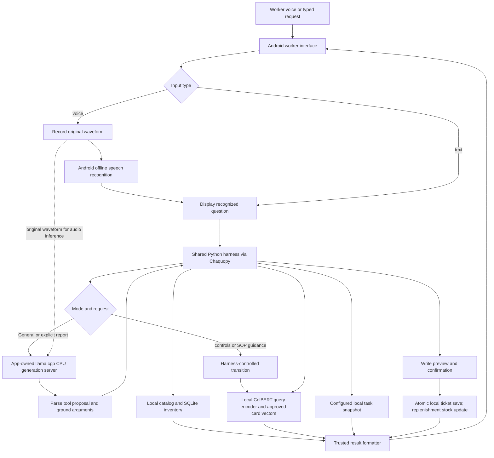

# Runtime architecture

Updated 2026-10-20. This document describes the implemented worker flow. Private checkpoint development is maintained separately.

## Responsibilities

The model proposes a supported tool and arguments. It does not execute SQL, authorize writes, invent retrieved answers, or generate safety procedures. The harness validates syntax, grounds names and variants, owns pending state, performs reads, and constructs concise results.

General mode supports inventory/location lookup, replenishment, and assigned-task lookup. SOP Advisor retrieves approved cards directly from the recognized or typed request. Explicit reporting intent requires a valid report proposal; accepting the current guidance report offer is a harness-owned exception that skips another generation call. Both routes still require a separate confirmed preview before saving.

There is one resident generation server for audio and text. ColBERT uses a separate on-demand embedding server; it is not a second chat model. Both bind to loopback. Generation uses CPU, four inference/batch threads, temperature zero, a 96-token output ceiling, 4,096 context capacity, and enabled prompt caching. The active private checkpoint is pinned by hashes in `CpuAudioRuntime.kt`.

## Audio and context

Voice processing includes separate Android offline transcription for display and harness control. In generation routes, the original waveform is passed to the audio model; the transcript is not substituted as the model input. SOP guidance and recognized control turns can bypass generation.

The visible feeds are not replayed as conversation history. Model-facing context contains the current pending tool, grounded fields, missing fields, latest question, and verified choices. Writes allow at most two follow-up questions after the opening request, then form fallback. Reads return grounded results/candidates without clarification questions. Completion, cancellation, mode switch, Clear, and Stop reset pending context as defined by the policy.

## State and safeguards

Catalog data, task snapshots, tickets, and worker feeds stay local. A confirmation is bound to the pending request and preview revision. Corrections invalidate old confirmation. Repeated confirmation cannot create duplicate tickets or stock additions. Confirmed replenishment saves its ticket and increments exactly the resolved inventory variant in one transaction; reports do not change stock.

Only approved applicable procedure cards are displayed. Similarity does not authorize a report. Unsupported guidance is not invented. Task creation and cross-request conversational memory are outside the demo scope.

## Timing and experiments

Model Lab reports generation first-text/completion latency in milliseconds with input-mode filters, percentile curves, and a reset window. The small grey time under an assistant response covers post-recording processing, including transcription, generation when used, and harness/retrieval work. These measurements have different boundaries.

Qualcomm Neural Network encoder/prefill-to-llama.cpp state transfer was tested separately from the app. It worked on the selected screen but did not establish a latency benefit for short worker requests. CPU remains the app default. Longer-context benefit, real warehouse noise robustness, and sustained device performance remain unverified.

See [developer operations](DEV_RUNBOOK.md), [profiling](../audio600m_profiling_runbook.md), and [harness details](MODEL_OUTPUT_AND_HARNESS.md).
